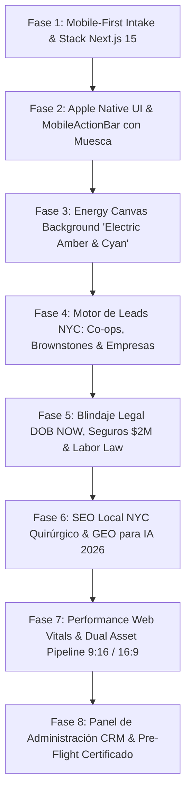

# ⚡ LOOP ENGINEERING V2 - WERB SOLUTIONS (NYC A+ CLASS PLATFORM)
## Arquitectura Mobile-First Estilo Apple App + Ecosistema Baterías Maresa / EnergyEngine

> **Misión:** Transformar `werbsolutions.com` en la plataforma líder indiscutible en **Manhattan, Brooklyn, Queens y Long Island**, combinando la experiencia de usuario nativa de una **App iOS de Apple** (con `MobileActionBar` elíptica, muesca central de llamada 24/7 y backdrop-blur háptico) con el rigor técnico, la captura de leads calificados y la protección jurídica de Nueva York (**NYC DOB NOW, Master Electrician License, Labor Law 240/241 y Local Law 97**).

---

---

## 🔁 CICLO COMPLETO DE LOOP ENGINEERING (8 FASES RIGUROSAS)

---

### 📱 FASE 1: MOBILE-FIRST INTAKE & MAPEO DE PÁGINAS Y SUBPÁGINAS
- **Estructura del Árbol de Rutas de la Web Original:**
  1. `/` -> **Home:** Hero interactivo con switch 9:16/16:9, sello Google Guaranteed, selector rápido de averías/proyectos, testimonios de vecinos de Manhattan/Brooklyn y botón de emergencia.
  2. `/about` -> **About Us / Credenciales:** Historia, equipo de Master Electricians registrados, número de licencia DOB (con dígitos protegidos), seguros activos y certificaciones OSHA.
  3. `/electrical-services` -> **Servicios Eléctricos Especializados:**
     - *Sub-módulo Residencial:* Reemplazo de paneles antiguos (60A a 200A), recableado de Brownstones (eliminación de Knob & Tube), cargadores EV para cocheras, iluminación empotrada Lutron.
     - *Sub-módulo Comercial:* Sistemas trifásicos (208V/480V), cableado estructurado para oficinas en Midtown/FiDi, mantenimiento de generadores y tableros principales.
  4. `/solar-&-eco-services` -> **Energía Solar & Eficiencia Urbana (Local Law 97):**
     - Techos solares comerciales y residenciales (Rooftops en Brooklyn & Queens), almacenamiento en baterías BESS, auditorías de carbono para evitar multas de la ciudad.
  5. `/construction-services` -> **Servicios de Construcción & Contratistas Generales:**
     - Gut-renovation, framing metálico, coordinación con arquitectos y cumplimiento riguroso de la **Scaffold Law (Labor Law 240/241)**.
  6. `/emergency-24-7` -> **Línea de Urgencia Inmediata:** Despacho rápido para cortes de luz, fuegos eléctricos y violaciones DOB.
  7. `/admin` -> **CRM Panel de Control:** Gestión interna de presupuestos, leads clasificados por condado y estados de permisos en DOB NOW.

---

### 🍏 FASE 2: EXPERIENCIA NATIVA DE APP APPLE & BARRA INFERIOR DE LUJO (`MobileActionBar`)
- **Adaptación directa del componente probado en Baterías Maresa (`MobileActionBar.tsx`):**
  - Barra fija inferior en celulares (`md:hidden fixed inset-x-0 bottom-0 z-50`).
  - **Silueta de Arco Elíptico:** Borde superior redondeado tipo cápsula (`rounded-t-[50%_1.75rem]`) con borde sutil translúcido (`border-t border-white/10`).
  - **Efecto Glassmorphism Ultra-Premium:** Fondo oscuro en `bg-[#0b0f17]/90` con `backdrop-blur-xl` y máscara radial de muesca (`notchMask`).
  - **Muesca Central con Botón Flotante de Emergencia 24/7:**
    - Botón circular prominente que sobresale del centro (`-top-[30px] h-[62px] w-[62px]`).
    - Color: Gradiente `Electric Amber / Fire Safety` (`#d97706` a `#f59e0b`) con anillo exterior brillante y microinteracción háptica `active:scale-95`.
    - Acción: Marcado telefónico instantáneo de emergencia (Tap to Call).
  - **4 Acciones Laterales Táctiles (Targets 44x44px):**
    1. 🔍 *Servicios* (Menú rápido modal interactivo).
    2. 📍 *Zonas NYC* (Manhattan, Brooklyn, Queens, Bronx, Staten Island con cálculo de cercanía).
    3. ⚡ *Cotizar DOB* (Calculadora / Wizard de presupuesto en 3 pasos).
    4. 💬 *WhatsApp / Chat VIP* (Soporte directo con técnicos certificados).

---

### ⚡ FASE 3: FONDO INTERACTIVO DE ENERGÍA Y SEGURIDAD (`EnergyBackground.tsx`)
- **Evolución del Canvas de Rayos a "Arc & Energy Traces":**
  - En lugar de rayos caóticos que generan sensación de cortocircuito o peligro, implementamos **filamentos de plasma dorado y arcos de cobre de alta precisión**:
    - Tonos: Ámbar eléctrico (`#f59e0b`), Núcleo incandescente cálido (`#fef3c7`) y Destellos azules de inspección (`#38bdf8`).
    - Comportamiento: Ondulan lentamente en el fondo del hero; al tocar la pantalla en móvil (Touch Event) o mover el puntero en escritorio, las partículas convergen suavemente creando un efecto magnético interactivo.
    - Rendimiento estricto: `requestAnimationFrame`, DPR limitado a 2, apagado con `IntersectionObserver` fuera de vista y respeto total a `prefers-reduced-motion` (frame estático).

---

### 🛡️ FASE 4: BLINDAJE JURÍDICO DE NUEVA YORK & SEGUROS DE $2M
- **Acreditación NYC DOB NOW:**
  - Registro de **NYC Licensed Master Electrician**.
  - Tramitación oficial de licencias y permisos mediante el sistema **DOB NOW: Inspections / Licensing**.
- **Paquete de Seguros Exigido por Juntas de Co-ops y Rascacielos:**
  - **Commercial General Liability:** $1,000,000 por incidente / $2,000,000 acumulado, con la Ciudad de Nueva York designada como *Additional Insured* en formulario CG 0001.
  - **Workers' Compensation & NYS Disability:** Cobertura ininterrumpida que libera de responsabilidad al propietario.
  - **New York Labor Law 240/241 (Scaffold Law):** Blindaje legal específico para trabajos en altura y remodelaciones integrales.
  - **Surety Performance Bonds:** Fianzas de garantía para proyectos de más de $50k.

---

### 💼 FASE 5: MOTOR DE CAPTURA DE LEADS CALIFICADOS (NYC LEAD WIZARD)
- Formulario de alta conversión dividido en pasos intuitivos para evitar fricción:
  - **Paso 1: ¿Dónde está tu propiedad?**
    - Manhattan (Condo / Co-op con junta)
    - Brooklyn (Brownstone histórico / Multifamiliar)
    - Queens / Long Island (Residencial o Comercial)
    - Oficinas / Locales en Midtown / FiDi
  - **Paso 2: ¿Qué necesitas resolver?**
    - Aumento de carga eléctrica a 200A / Panel Upgrade
    - Arreglar infracción del DOB / Certificado de Inspección
    - Instalación de iluminación arquitectónica / Smart Home Lutron
    - Paneles solares en techo o cargador de auto eléctrico (EV)
    - Emergencia eléctrica 24/7
  - **Paso 3: Contacto y Agendamiento en 1 Clic:**
    - Nombre, teléfono, dirección aproximada y fecha deseada de visita técnica.
    - Notificación inmediata a la bandeja del administrador y confirmación por SMS al cliente.

---

### 🖼️ FASE 6: DUAL ASSET PIPELINE (9:16 MÓVIL & 16:9 DESKTOP)
- Cada sección visual de la web contará con dos variantes de imagen:
  - Móvil (`9:16`): Encuadre vertical enfocado en el sujeto y la acción técnica, dejando aire para el texto y la barra de navegación inferior.
  - Escritorio (`16:9`): Vista panorámica que exhibe la arquitectura de Manhattan, el skyline y la magnitud de la obra.
- Formato **WebP nativo** con etiquetas `<picture>` y media queries optimizadas para que el celular no descargue la versión de escritorio ni viceversa.

---

### 🔍 FASE 7: SEO LOCAL QUIRÚRGICO (ISLAS Y BARRIOS) & GEO 2026
- **Silos de Localidad para ser el #1 en Google Local Services & Map Pack:**
  - Páginas de aterrizaje dedicadas: *Electrician in Tribeca, Upper East Side Master Electricians, Brooklyn Heights Electrical Upgrades, DUMBO Loft Rewiring, Astoria Queens Commercial Electricians, Long Island City Solar Rooftops*.
- **GEO (Generative Engine Optimization para IA):**
  - Creación de `public/llms.txt` y `public/llms-full.txt` con síntesis de tarifas, licencias y respuestas directas para ChatGPT, Perplexity, Claude y Copilot.
  - Esquema Schema.org JSON-LD de `Electrician` y `GeneralContractor` con `areaServed` geolocalizado con coordenadas de Manhattan y Brooklyn.

---

### 🧪 FASE 8: PRE-FLIGHT, CERTIFICACIÓN A+ & RETENCIÓN DE PUSH
- Validación estricta:
  1. `npx tsc --noEmit` -> 0 errores.
  2. `npm run lint` -> 0 advertencias bloqueantes.
  3. `npm run build` -> Exit code 0 en producción.
- **Regla inviolable de Git:** **NO se realiza `git push` sin la orden explícita de Pablo.**
